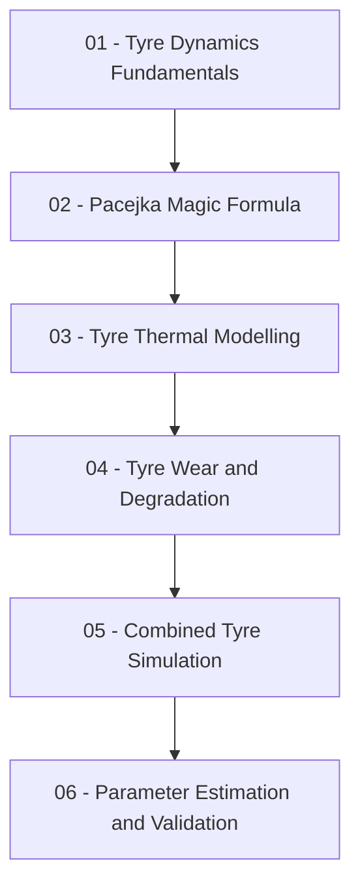
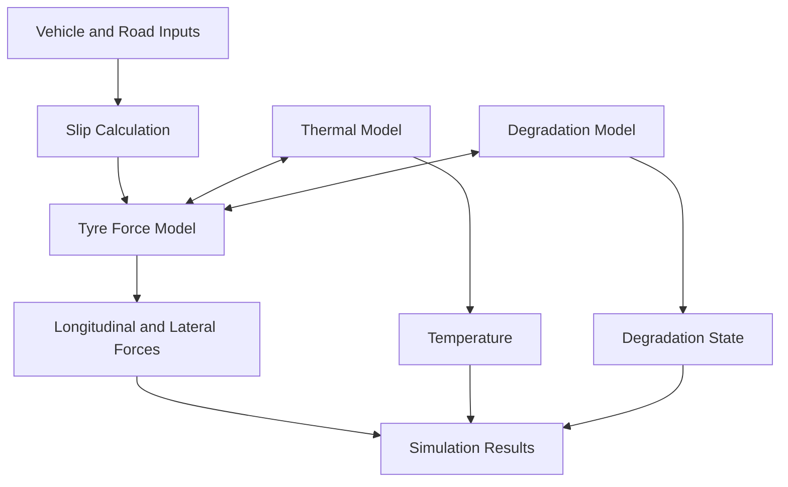

# 🏁 Tyre Dynamics & Thermal Modelling

### A MATLAB & Python Simulation Study of Tyre Force Generation, Thermal Response and Performance Degradation

**Understanding, modelling and simulating tyre behaviour under different operating conditions.**

---

## 📌 Project Overview

This project focuses on the mathematical modelling, simulation and analysis of automotive tyre dynamics and thermal behaviour using MATLAB and Python.

The main objective is to develop a modular simulation framework to investigate tyre force characteristics, slip behaviour, temperature development, warm-up characteristics and performance degradation.

The project follows a progressive engineering approach, beginning with fundamental tyre dynamics and advancing towards an integrated tyre force, thermal and degradation model.

### 🎯 Main Modelling Areas

| 🛞 Tyre Dynamics | 🌡️ Thermal Modelling | 📉 Degradation |
|:---:|:---:|:---:|
| Longitudinal and lateral forces | Heat generation and dissipation | Wear behaviour |
| Slip ratio and slip angle | Temperature development | Performance degradation |
| Pacejka Magic Formula | Warm-up and cooling | Temperature-dependent performance |

> **Project status:** This is an ongoing educational and engineering modelling project. Initial models will use simplified assumptions. Experimental validation will only be claimed when suitable measured data are available.

---

## 🧭 Project Development Roadmap

| Stage | Focus | Planned outcome |
|:---:|---|---|
| 01 | Tyre Dynamics | Basic longitudinal and lateral force models |
| 02 | Pacejka Model | Nonlinear tyre force prediction |
| 03 | Thermal Model | Temperature and warm-up simulation |
| 04 | Degradation | Simplified tyre wear model |
| 05 | Integration | Combined tyre simulation framework |
| 06 | Validation | Parameter estimation and model evaluation |

---

# 01. 🛞 Tyre Dynamics Fundamentals

**Understanding slip, forces and tyre-road interaction.**

The first stage investigates how tyres generate forces during acceleration, braking and cornering.

### 1.1 Longitudinal Slip Ratio

Longitudinal slip describes the difference between the wheel's circumferential velocity and the vehicle's longitudinal velocity.

\[
\kappa = \frac{R_e\omega - V_x}{\max(|V_x|,\epsilon)}
\]

| Parameter | Description | Unit |
|---|---|---|
| \(R_e\) | Effective rolling radius | m |
| \(\omega\) | Wheel angular velocity | rad/s |
| \(V_x\) | Longitudinal vehicle velocity | m/s |
| \(\kappa\) | Longitudinal slip ratio | - |

*The sign convention and low-speed handling will be defined consistently in the implementation.*

### 1.2 Lateral Slip Angle

Slip angle represents the difference between the direction in which the wheel is pointing and its actual direction of travel.

A simplified expression is:

\[
\alpha = \tan^{-1}\left(\frac{V_y}{|V_x|}\right)-\delta
\]

Where:

- \(V_y\): Lateral velocity at the wheel
- \(V_x\): Longitudinal velocity
- \(\delta\): Steering angle

### 1.3 Tyre Force Components

| Force | Description | Engineering relevance |
|---|---|---|
| \(F_x\) | Longitudinal force | Acceleration and braking |
| \(F_y\) | Lateral force | Cornering |
| \(F_z\) | Vertical force | Normal tyre loading |

A simplified friction-circle relationship is:

\[
\sqrt{F_x^2+F_y^2}\leq \mu F_z
\]

This relationship provides an initial approximation of the available tyre-road friction.

### Planned Implementation

1. Study tyre-road interaction and friction characteristics.
2. Develop mathematical relationships for longitudinal and lateral forces.
3. Implement the equations in MATLAB and Python.
4. Simulate force characteristics for different slip conditions.
5. Investigate the influence of normal load and friction.
6. Analyse the resulting force-versus-slip curves.

### Illustrative Simulation Results

**Longitudinal Force vs Slip Ratio**

**Lateral Force vs Slip Angle**

*Illustrative plots generated using simplified mathematical relationships, not experimental tyre measurements.*

---

# 02. 📐 Pacejka Magic Formula Modelling

**Mathematically predicting nonlinear tyre force characteristics.**

The Pacejka Magic Formula is an empirical approach used to represent nonlinear tyre force behaviour as a function of slip.

### 2.1 Magic Formula Equation

A simplified pure-slip formulation is:

\[
y=D\sin\left(C\tan^{-1}
\left[Bx-E(Bx-\tan^{-1}(Bx))\right]\right)
\]

Including horizontal and vertical shifts:

\[
x=X+S_h
\]

\[
Y=y+S_v
\]

### 2.2 Model Parameters

| Parameter | Meaning | Influence |
|---|---|---|
| B | Stiffness factor | Initial slope |
| C | Shape factor | Curve shape |
| D | Peak factor | Maximum response |
| E | Curvature factor | Behaviour near the peak |
| Sh | Horizontal shift | Horizontal offset |
| Sv | Vertical shift | Vertical offset |

### Planned Implementation

1. Study the mathematical structure of the Magic Formula.
2. Implement the equation as reusable MATLAB and Python functions.
3. Investigate the influence of B, C, D and E.
4. Generate nonlinear force-versus-slip characteristics.
5. Perform parameter estimation using suitable reference datasets.
6. Compare Magic Formula results with the simplified tyre force model.
7. Document assumptions and model limitations.

### Expected Simulation Outputs

- Longitudinal force versus slip ratio.
- Lateral force versus slip angle.
- Comparison of different parameter combinations.
- Parameter sensitivity plots.
- Curve fitting and estimation results.

> **Scope:** The initial model will be a simplified pure-slip Magic Formula, not a complete MF-Tyre or MF-Swift implementation. Combined slip, camber, load dependency and transient tyre behaviour are potential future extensions.

---

# 03. 🌡️ Tyre Thermal Modelling

**Investigating temperature development, heat transfer and warm-up behaviour.**

Tyre temperature is an important operating variable that can influence tyre performance.

This stage will begin with a simplified lumped-parameter thermal model.

### 3.1 Thermal Energy Balance

The initial thermal model will be based on:

\[
C_{th}\frac{dT}{dt}
=
\dot Q_{in}-H(T-T_{amb})
\]

Where:

| Parameter | Description | Unit |
|---|---|---|
| \(C_{th}\) | Effective thermal capacity | J/K |
| \(T\) | Modelled tyre temperature | °C or K |
| \(T_{amb}\) | Ambient temperature | °C or K |
| \(\dot Q_{in}\) | Heat input rate | W |
| \(H\) | Effective heat-transfer coefficient | W/K |

### 3.2 Numerical Implementation

For numerical simulation, forward Euler integration can initially be used:

\[
T_{k+1}=T_k+
\frac{\Delta t}{C_{th}}
\left[\dot Q_{in,k}-H(T_k-T_{amb,k})\right]
\]

### Planned Implementation

1. Study tyre heat generation and heat transfer.
2. Define thermal parameters and initial conditions.
3. Develop the single-node thermal model.
4. Implement the equations in MATLAB and Python.
5. Simulate temperature development under different heat-input conditions.
6. Investigate warm-up and cooling characteristics.
7. Study the potential relationship between temperature and tyre force.

### Illustrative Thermal Response

*Illustrative first-order thermal response using assumed parameters.*

### Future Thermal Extensions

- Tread and carcass temperature modelling.
- Multi-node thermal models.
- Improved friction-related heat generation.
- Road and ambient heat-transfer effects.
- Temperature-dependent tyre force characteristics.

> **Model limitation:** A single-node model represents one effective tyre temperature. It does not resolve actual temperature gradients through the tyre structure.

---

# 04. 📉 Tyre Wear and Performance Degradation

**Investigating how tyre performance changes with operating conditions.**

This stage will introduce simplified approaches to representing tyre wear and degradation.

### Planned Implementation

1. Study the main mechanisms influencing tyre wear.
2. Investigate the influence of slip, load and temperature.
3. Define a suitable degradation state or indicator.
4. Develop a simplified mathematical degradation relationship.
5. Investigate the effect of degradation on tyre force characteristics.
6. Study possible interactions between thermal behaviour and degradation.

### Initial Mathematical Concept

A model parameter could be represented as:

\[
p(t)=p_0\,g(w(t),T(t))
\]

Where:

- \(p_0\): Baseline model parameter
- \(w(t)\): Selected degradation state
- \(T(t)\): Modelled tyre temperature
- \(g\): Relationship to be defined during development

This is a conceptual modelling approach; the degradation relationship will require suitable physical justification and parameterisation.

---

# 05. 🔗 Combined Tyre Simulation

**Integrating force, temperature and degradation models.**

The long-term objective is to connect the individual models into a modular simulation framework.

### Proposed Model Architecture

### Model Integration Plan

| Subsystem | Inputs | Outputs |
|---|---|---|
| Slip calculation | Wheel speed, vehicle speed, steering | Slip ratio and slip angle |
| Force model | Slip, normal load, model parameters | \(F_x,F_y\) |
| Thermal model | Heat input, ambient temperature | Tyre temperature |
| Degradation model | Operating conditions, degradation state | Degradation indicator |
| Combined model | Individual subsystem outputs | Integrated tyre response |

### Planned Simulation Scenarios

- Straight-line acceleration.
- Braking under different slip conditions.
- Steady-state cornering.
- Different normal-load conditions.
- Warm-up and cooling cycles.
- Combined thermal and force-response investigations.

---

# 06. 🧪 Simulation, Parameter Estimation and Validation

Each model will follow a structured engineering workflow.

| Step | Activity | Expected evidence |
|---|---|---|
| 01 | Literature review | Technical references |
| 02 | Mathematical formulation | Equations and assumptions |
| 03 | Model implementation | MATLAB/Python functions |
| 04 | Simulation | Reproducible simulation scripts |
| 05 | Data visualisation | Force and temperature plots |
| 06 | Parameter estimation | Estimated model coefficients |
| 07 | Verification | Numerical and mathematical checks |
| 08 | Validation | Comparison with reference data |
| 09 | Documentation | Results and limitations |

**Verification:** Checking whether the model has been implemented correctly.

**Validation:** Assessing whether the model represents real tyre behaviour using suitable reference or experimental data.

---

## 🧰 Tools and Technologies

| Technology | Application |
|---|---|
| MATLAB | Mathematical modelling and simulation |
| Simulink | Future subsystem integration |
| Python | Model development and analysis |
| NumPy | Numerical calculations |
| SciPy | Parameter estimation and optimisation |
| Pandas | Data processing |
| Matplotlib | Graphs and visualisation |
| Git / GitHub | Version control and documentation |

### 🏁 Learning. Modelling. Simulating. Validating.

**An ongoing engineering project exploring tyre behaviour through mathematical modelling and simulation.**

modelling.
- Integration with vehicle dynamics simulations.
- Investigation of tyre behaviour under motorsport operating conditions.
